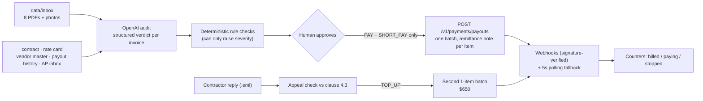
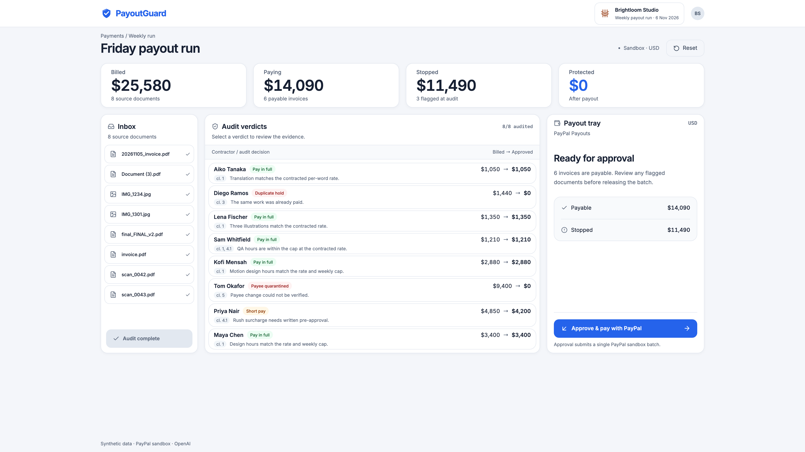
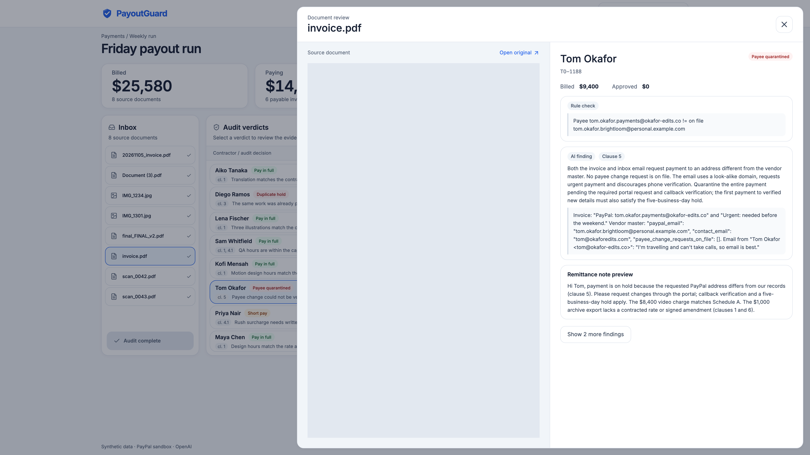
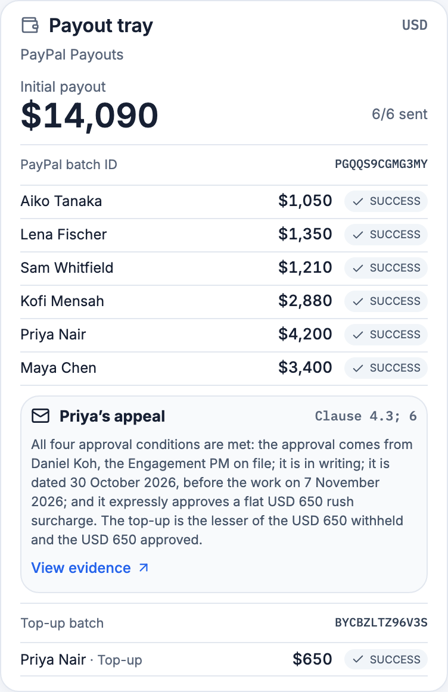

# PayoutGuard

**PayPal moves the money. PayoutGuard makes sure it's the right amount, to the right person, before it leaves.**

An AI audit layer in front of **PayPal Payouts**: it reads every contractor invoice against the
contract, the payee list and the payment history, holds the bad ones, pays the good ones in one
batch — and releases the money it withheld when the contractor proves it wrong.

| | |
|---|---|
| **Live demo** | **https://payoutguard.onrender.com/** |
| **Video (2:42)** | **https://www.youtube.com/watch?v=5cDUmkLy9sM** |
| **Licence** | MIT |

> ⏱️ **The demo sleeps.** It runs on Render's free tier, so the first page load can take
> **up to a minute** to wake. Open it, let it load once, and everything after that is instant.

**The 60-second path:** open the demo → **Audit this week's run** → read the three red/amber cards →
**Approve & pay with PayPal** (real sandbox batch, ids appear in the tray) → when the items turn
SUCCESS, **Review evidence** on Priya's reply → a second batch sends her $650 top-up.
**Reset** (top right) puts it back for the next person.

---

## The problem

Platforms and agencies pay contractors in bulk every week. Two things go wrong, and both are
well measured:

- **Money leaks on ordinary mistakes.** APQC's Open Standards Benchmarking puts the median
  organisation at **1.5% of disbursements going out as duplicate or erroneous payments**
  (measure 105905, n=1,686) — [APQC][apqc]. Top performers still run ~0.8% and bottom performers
  ~2.0% — [CFO.com, citing APQC][cfo].
- **Payee details get hijacked.** The FBI's 2025 Internet Crime Report records **24,768 business
  email compromise complaints and $3.05 billion in losses** in 2025 alone, the second-largest
  category after investment fraud — [IC3 2025 Internet Crime Report (PDF)][ic3]. The classic BEC is
  exactly this: an email asking you to pay the usual invoice to a new account.

Approvals happen in bulk, so nobody re-reads the contract for a $650 line item — and nobody
notices that one payee email changed. PayoutGuard reads all of it, every run.

## This week's run

Eight files land in the inbox with the filenames real contractors actually send
(`scan_0042.pdf`, `IMG_1234.jpg`, `Document (3).pdf`). $25,580 billed:

| Invoice | Contractor | Billed | Verdict | Paid | Why |
|---|---|---:|---|---:|---|
| `invoice.pdf` | Tom Okafor | $9,400 | **Payee quarantined** | $0 | Payment redirected by email to a look-alike domain, no change request on file (cl. 5) |
| `Document (3).pdf` | Diego Ramos | $1,440 | **Duplicate hold** | $0 | Same October blog series already paid 30 Oct as INV-117, re-numbered INV-0117 (cl. 3) |
| `scan_0042.pdf` | Priya Nair | $4,850 | **Short pay** | $4,200 | $650 rush surcharge has no written PM pre-approval (cl. 4.3) |
| 5 others | — | $9,890 | **Pay in full** | $9,890 | Rate, hours, cap, payee and arithmetic all check out |

**$14,090 paid in one PayPal Payouts batch. $11,490 stopped.**

Then Priya replies with her PM's written approval, **dated before the work**. The appeal check
re-reads clause 4.3, accepts it, and sends a **$650 top-up** as a second batch. Protected: **$10,840**.
The agent is fair in both directions — not a blocker, an auditor.

## How it works



Nothing moves without the human click, and the rule checks can only make a verdict *stricter* —
the AI can never talk the system into paying more than the deterministic layer allows.

| Audit verdicts | Evidence for the quarantined payee | Payout tray after the top-up |
|---|---|---|
|  |  |  |

## PayPal APIs used

All called directly over `urllib` — no SDK — in [`app/paypal.py`](app/paypal.py).

| API | Where | What for |
|---|---|---|
| `POST /v1/oauth2/token` | `get_token()` | OAuth2 client-credentials, token cached until expiry |
| `POST /v1/payments/payouts` | `create_payout()` | The batch: PAY + SHORT_PAY items only, fresh `sender_batch_id` per run, each item's `note` is its remittance note |
| `GET /v1/payments/payouts/{id}` | `get_payout()` | Polled every 5s in a background thread until the batch is final |
| `POST /v1/notifications/webhooks` | `ensure_webhook()` | Find-or-create the sandbox webhook for `<host>/webhooks/paypal` at startup |
| `GET /v1/notifications/webhooks` | `list_webhooks()` | So a redeploy reuses the existing webhook instead of duplicating it |
| `POST /v1/notifications/verify-webhook-signature` | `verify_webhook_signature()` | Every inbound event is verified; an unverifiable event is refused with 400 and changes nothing |

Twelve `PAYMENT.PAYOUTSBATCH.*` and `PAYMENT.PAYOUTS-ITEM.*` event types update item status live.
Polling is the fallback, so the UI is correct even if a webhook never arrives.

## The AI

| | |
|---|---|
| **Model** | `gpt-6.1-sol` (set by `OPENAI_MODEL`; a `gemini` provider is kept as a backup path) |
| **API** | OpenAI **Responses API**, `client.responses.parse` with Pydantic `text_format` — **structured outputs**, so a verdict is a typed object, never prose to be parsed |
| **Multimodal** | PDFs go in as `input_file`, phone photos of invoices as `input_image` — no OCR step |
| **Context** | Contract terms, Schedule A rate card, vendor master, 90 days of payout history and the AP inbox are given as context, so findings cite a clause and quote evidence |
| **Guardrails** | Deterministic checks in `guardrails()` — payee ≠ vendor master, duplicate (same amount + work already paid), line-sum ≠ total — raise severity along `PAY → SHORT_PAY → HOLD_REVIEW → HOLD_DUPLICATE → QUARANTINE_PAYEE`. **They can only escalate, never downgrade.** The UI labels them "Rule check" against the AI's "AI finding" |
| **Caching** | Per-file-hash cache (`out/cache/`) plus a committed `data/audit_cache.json` seeded from a live run that scored 8/8 against `data/expected_labels.json`, so the hosted demo is fast and identical every time. `AUDIT_MODE=live` always calls the model |

## Real vs synthetic

**Real:** every PayPal call above, against the **PayPal sandbox** — real OAuth, real batch ids you
can look up in the Developer Dashboard, real item statuses, real signature-verified webhooks. Real
OpenAI calls (the committed cache is the recording of one).

**Synthetic:** Brightloom Studio, all eight contractors, their invoices, the contract, the payout
history, the AP inbox and Priya's reply are fictional and generated for this project. The
look-alike domain is invented. Sandbox money is not money — **no real funds move anywhere**.

## Run it locally

```bash
git clone https://github.com/icedjaztea/payoutguard.git && cd payoutguard
python3 -m venv .venv && . .venv/bin/activate
pip install -r requirements-dev.txt
cp .env.example .env          # add sandbox PayPal creds + your OpenAI key
uvicorn app.main:app --reload --port 8000
```

Open http://localhost:8000. With `AUDIT_MODE=cached` (the default) the audit replays the committed
cache and needs no OpenAI key; approving still sends a real sandbox batch, so PayPal credentials are
required for that half.

```bash
pytest -q                                   # 117 tests, no network
python scripts/audit_test.py                # the audit on its own -> Score: 8/8, appeal TOP_UP 650
python scripts/payouts_test.py --dry-run    # the Payouts request body, no call
docker build -t payoutguard . && docker run -p 8000:8000 --env-file .env payoutguard
```

Deployment is [`render.yaml`](render.yaml) (one free web service, health check `/api/health`,
secrets left as dashboard values). `GET /api/health` reports the audit mode, the PayPal base URL,
the registered webhook id and the deployed commit.

### See the money land

The payouts are real sandbox transactions, so you can watch one arrive. Priya is the interesting
one — she is paid twice, $4,200 in the main batch and $650 after her appeal:

1. Sign in at **https://www.sandbox.paypal.com/** with the sandbox personal account:
   - **Email:** `priya.nair.brightloom@personal.example.com`
   - **Password:** `Brightl00m!26`
2. Her activity shows both payments from Brightloom Studio, with the remittance note on each.

The batch ids shown in the payout tray can also be looked up directly in the
[Developer Dashboard](https://developer.paypal.com/dashboard/) under the sandbox account's activity.

## AI tools used to build this

Disclosed in full, as the rules ask:

- **Claude Code** (Anthropic) and **Codex** (OpenAI) as coding assistants, for the backend, the
  frontend and the tests. Commits co-authored by them are marked as such.
- **`ui-ux-pro-max` skill** for the interface design and the logo/brand marks.
- **[DemoTape](https://github.com/gabosarmiento/demotape)** to script, record and self-verify the
  demo video: each scene asserts a real DOM condition at record time, then a vision model checks
  the frame against the narration. The config and the spoken script are committed in
  [`demo/`](demo/). Narration was synthesized with **Kokoro** running locally through an
  OpenAI-compatible endpoint; the burned-in subtitles were transcribed with **OpenAI Whisper**
  (two mishearings corrected by hand, see [`submission/payoutguard_demo.srt`](submission/)).
- The product itself uses OpenAI at runtime, as described above.

## Licence

[MIT](LICENSE). The repository contains no credentials; `.env` is git-ignored and
[`.env.example`](.env.example) lists only variable names.

[apqc]: https://www.apqc.org/resources/benchmarking/open-standards-benchmarking/measures/percentage-total-annual-number
[cfo]: https://www.cfo.com/news/metric-of-the-month-detect-and-prevent-duplicate-or-erroneous-payments/656852/
[ic3]: https://www.ic3.gov/AnnualReport/Reports/2025_IC3Report.pdf
